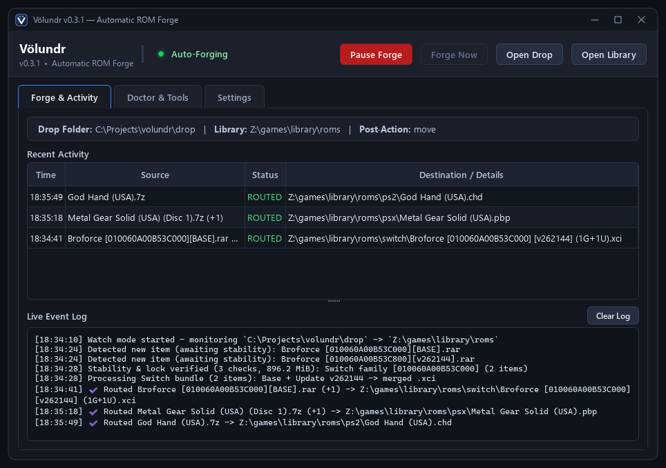
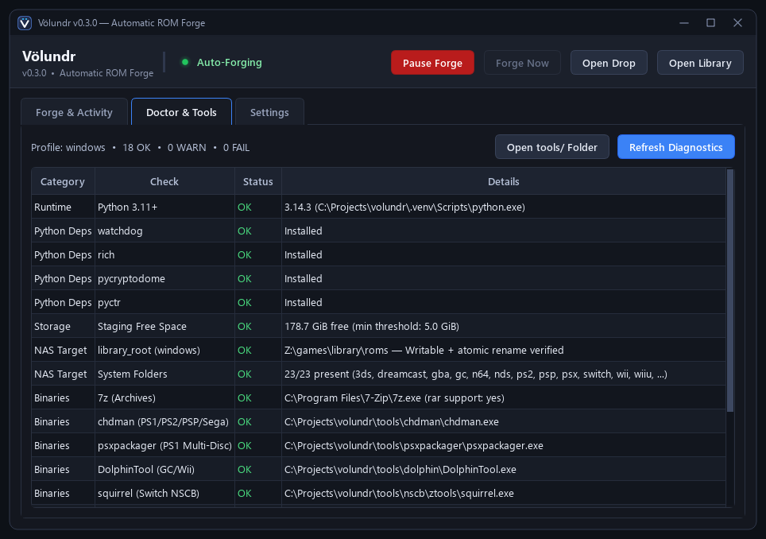
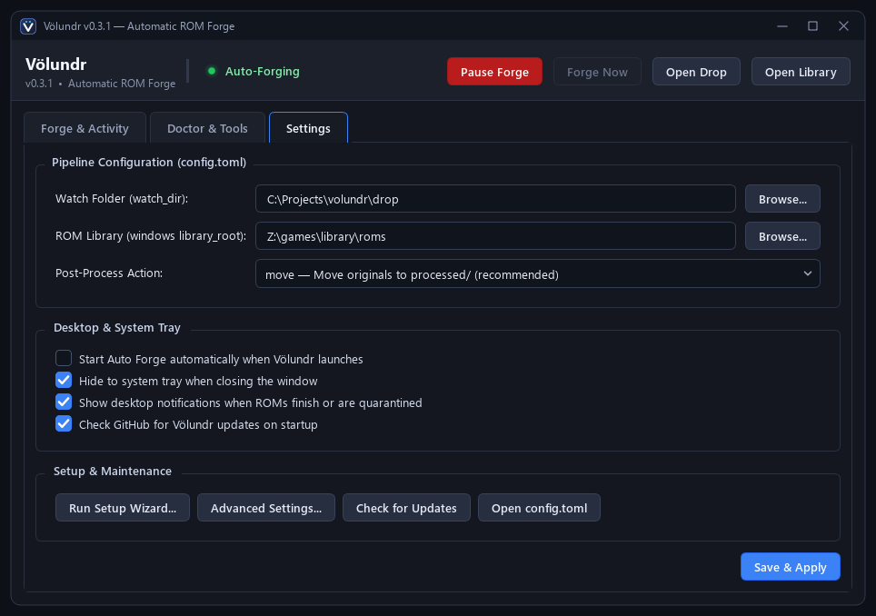
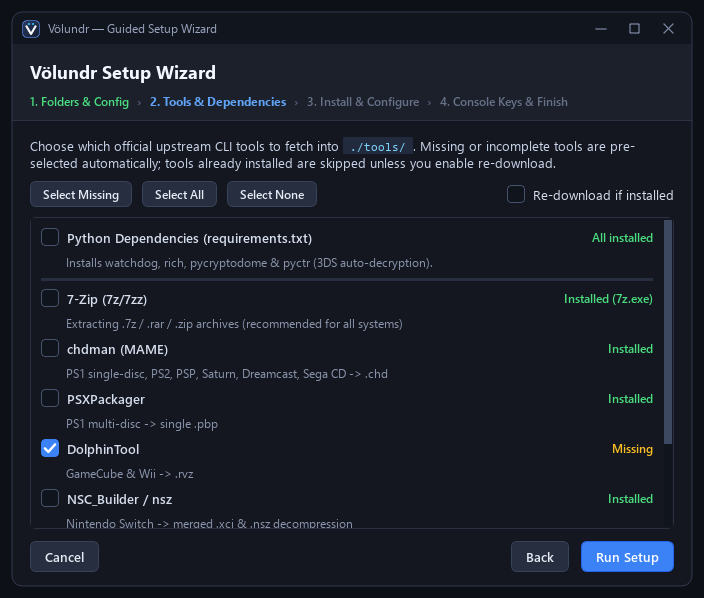

#  Völundr

[](https://younglordace.github.io/volundr/)
[](LICENSE)

**Automatic ROM Processor — drop ROM archives in → get clean, compressed, emulator-ready games sorted into your library automatically.**

Völundr identifies consoles via binary headers, converts games to their optimal emulator format (`.chd`, `.pbp`, `.rvz`, `.xci`, `.cci`, `.wua`, Vita3K `.zip`), and moves everything safely into your local drive or NAS. Available as a **native Desktop App + System Tray (Windows & Linux)** or a lightweight **headless CLI / Docker container**.

**Full Documentation:** [younglordace.github.io/volundr](https://younglordace.github.io/volundr/)



<details>
<summary><strong>More Screenshots (Doctor & Tools, Settings, Setup Wizard, & CLI)</strong></summary>

#### Doctor & Tools


#### Settings & System Tray


#### Built-in First-Time Setup Wizard


#### Headless CLI Watch Mode


</details>

---

## Quick Start (Desktop App — Recommended)

Requires **Python 3.11+** ([python.org](https://www.python.org/downloads/) — on Windows you can also run `winget install -e --id Python.Python.3.13`).

### Windows (Easiest — Double-Click Launcher)
1. **Download or clone Völundr:**
   ```powershell
   git clone https://github.com/YoungLordAce/volundr.git
   ```
   *(Cloning with Git lets you use the built-in one-click **Check for Updates** button later.)*
2. **Double-click `Start Volundr.bat`** inside the `volundr` folder.
   - On first launch, it automatically sets up `.venv` and installs all Python + GUI dependencies.
   - The **Setup Wizard** opens automatically to pick your ROM library folder and download the official external CLI tools for the consoles you want.
3. Click **Start Watching** (or **Scan Now**) and drop ROMs into `./drop`!

### Linux / macOS
```bash
git clone https://github.com/YoungLordAce/volundr.git
cd volundr
python3 -m venv .venv
./.venv/bin/pip install -r requirements.txt -r requirements-gui.txt
./.venv/bin/python main.py gui
```

> **Running on a NAS or Headless Server?** The included [`Dockerfile`](Dockerfile) pre-installs almost every CLI tool automatically. See the **[Docker & NAS Guide](https://younglordace.github.io/volundr/docker-nas/)**.

---

## Optional User-Supplied Console Keys

The Setup Wizard downloads free upstream CLI tools (`7z`, `chdman`, `PSXPackager`, `DolphinTool`, `NSC_Builder`, `ZArchive`, `CDecrypt`, `pkg2zip`), but Völundr **never** downloads copyrighted keys or license databases. If you ingest these systems, place your own legally dumped files into `./tools/` *(click **Open `tools/` Folder** in the Doctor tab)*:

| System | Files | Where to Place Them | What It Enables |
| :--- | :--- | :--- | :--- |
| **Nintendo Switch** | `prod.keys` *(or `keys.txt`)* | `tools/nscb/ztools/` *(or `~/.switch/prod.keys`)* | Required by `squirrel` for `.xci` merging & `.nsz` decompression *(auto-synced to `keys.txt`)* |
| **Nintendo 3DS** | `aes_keys.txt` / `boot9.bin` *(+ optional `seeddb.bin`)* | `tools/3ds/` | Auto-decrypts encrypted `.3ds` dumps and converts Base Game `.cia` packages (`00040000...`) to decrypted `.cci` for Azahar & Cocoon *(Updates/DLC stay in `3ds/_cia_install/`)* |
| **PS Vita** | `PSV_GAMES.tsv`, `PSV_DLCS.tsv`, `PSV_UPDATES.tsv` | `tools/psvita/` | Automatic `zRIF`/`work.bin` license generation and title normalization for `.pkg` files |

---

## Updating

- **In the Desktop App:** Go to **Settings → Check for Updates** (or click the **Update Available** banner) and hit **Update** — Völundr safely pulls the latest release, refreshes dependencies, and restarts while leaving your `config.toml`, `tools/`, and keys untouched.
- **From the CLI:** Run `git pull` inside your `volundr` folder.

---

<details>
<summary><strong>Headless CLI Setup & Everyday Commands</strong></summary>

Prefer running without a GUI? Use the stdlib-only CLI setup script:

```bash
python setup_volundr.py          # Interactive setup (add --dry-run to preview)
```

| Command | What It Does |
| :--- | :--- |
| `python main.py gui [--minimized]` | Launch the Desktop GUI (`--autowatch` / `--no-autowatch` overrides startup mode) |
| `python main.py watch` | Continuously monitor `./drop` and ingest dropped ROMs automatically |
| `python main.py scan [--dry-run]` | One-shot pass over everything currently in `./drop` |
| `python main.py inspect <path...>` | Read-only preview showing detected system and planned action |
| `python main.py process <path...> [--dry-run]` | Ingest specific file(s) or folder(s) directly |
| `python main.py doctor` | Check Python deps, external tools, disk space, and `library_root` write access |

</details>

<details>
<summary><strong>External CLI Tools Reference (Auto-Installed by the Setup Wizard)</strong></summary>

Völundr checks both your system `PATH` and `./tools/` automatically. Cartridge systems (**NES, SNES, N64, GBA, NDS**) and **Arcade** sets (**CPS1/2/3, Neo Geo, FBNeo**) need no conversion tools beyond 7-Zip for `.7z`/`.rar` archives.

| Tool | Needed For | Official Download | Where to Place It |
| :--- | :--- | :--- | :--- |
| **7-Zip** (`7z` / `7zz`) | `.7z`, `.rar`, `.zip` archives | [7-zip.org](https://www.7-zip.org/download.html) / [ip7z/7zip](https://github.com/ip7z/7zip/releases) | **Win:** `tools/7z/7z.exe` *(or Program Files)*<br>**Linux:** `tools/7z/7zz` or `PATH` |
| **chdman** | PS1, PS2, PSP, Saturn, Dreamcast, Sega CD, PCE CD → `.chd` | [MAME Releases](https://github.com/mamedev/mame/releases) | **Win:** `tools/chdman/chdman.exe`<br>**Linux:** `mame-tools` on `PATH` |
| **PSXPackager** | PS1 multi-disc → single `.pbp` | [PSXPackager Releases](https://github.com/RupertAvery/PSXPackager/releases) | **Win:** `tools/psxpackager/psxpackager.exe`<br>**Linux:** `tools/psxpackager/psxpackager` |
| **DolphinTool** | GameCube & Wii → `.rvz` | [Dolphin Downloads](https://dolphin-emu.org/download/) | **Win:** `tools/dolphin/DolphinTool.exe`<br>**Linux:** `dolphin-emu-tool` on `PATH` |
| **NSC_Builder** / **nsz** | Nintendo Switch → merged `.xci` & `.nsz` | [NSC_BUILDER](https://github.com/julesontheroad/NSC_BUILDER) / [nsz](https://github.com/nicoboss/nsz) | **Win:** `tools/nscb/ztools/squirrel.exe`<br>**Linux:** `tools/nscb/ztools/squirrel.py` or `nsz` |
| **ZArchive** *(optional)* | Wii U Loadiine → `.wua` | [ZArchive Releases](https://github.com/Exzap/ZArchive/releases) | **Win:** `tools/wiiu/zarchive.exe`<br>**Linux:** `tools/wiiu/zarchive` or `PATH` |
| **CDecrypt** *(optional)* | Wii U encrypted WUP/NUS | [CDecrypt Releases](https://github.com/VitaSmith/cdecrypt/releases) | **Win:** `tools/wiiu/cdecrypt.exe`<br>**Linux:** `tools/wiiu/cdecrypt` or `PATH` |
| **pkg2zip** *(optional)* | PS Vita `.pkg` → Vita3K `.zip` | [pkg2zip Releases](https://github.com/lusid1/pkg2zip/releases) | **Win:** `tools/psvita/pkg2zip.exe`<br>**Linux:** `tools/psvita/pkg2zip` or `PATH` |

</details>

---

## Documentation

Browse the full guide at **[younglordace.github.io/volundr](https://younglordace.github.io/volundr/)**:
- **[Desktop GUI](https://younglordace.github.io/volundr/desktop-gui/):** System tray, Setup Wizard, Advanced Settings, and one-click updater
- **[Supported Consoles](https://younglordace.github.io/volundr/consoles/):** Per-console conversion rules, multi-disc `.pbp`/`.m3u`, CUE healing, Switch donor caching & duplicate update skip, 3DS/Wii U/PS Vita behavior
- **[Docker & NAS](https://younglordace.github.io/volundr/docker-nas/):** 24/7 headless Docker deployment, Syncthing atomic transfers, and ROMarr two-library integration
- **[Configuration](https://younglordace.github.io/volundr/configuration/) & [Architecture](https://younglordace.github.io/volundr/architecture/):** Full `config.toml` reference, `src/` module map, and running tests

---

## Note & Disclaimer

> **Project Status:** Personal homelab project shared as-is under the [GNU General Public License v3.0 (GPLv3)](LICENSE). Pull requests and bug reports are welcome; support is best-effort.
>
> **Disclaimer:** Völundr includes **no** copyrighted ROMs, BIOS files, console decryption keys, license databases, or third-party executables. You must supply your own legal dumps, keys dumped from hardware you own, and third-party CLI tools.
