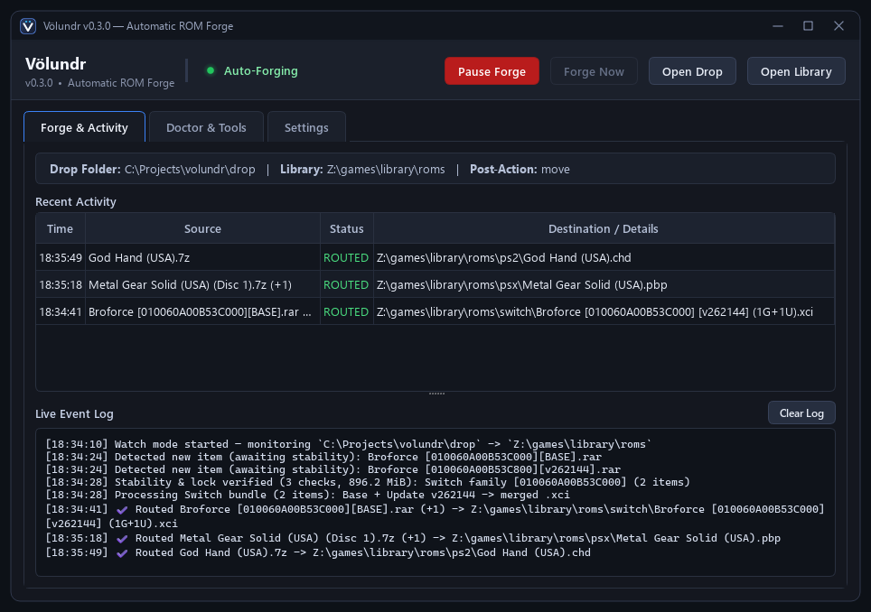
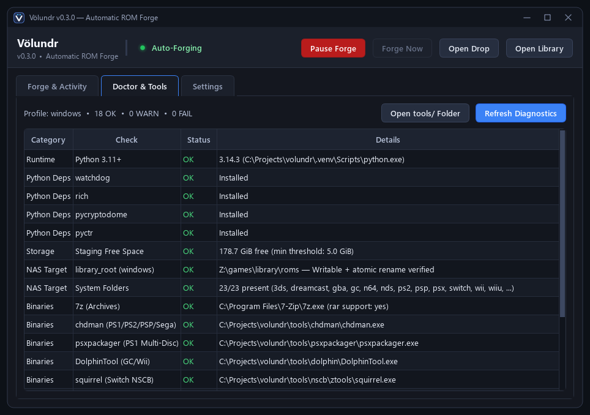
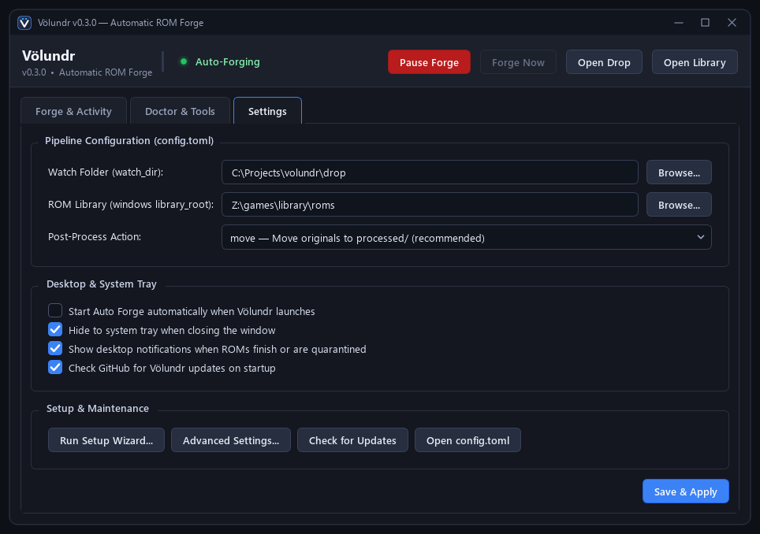
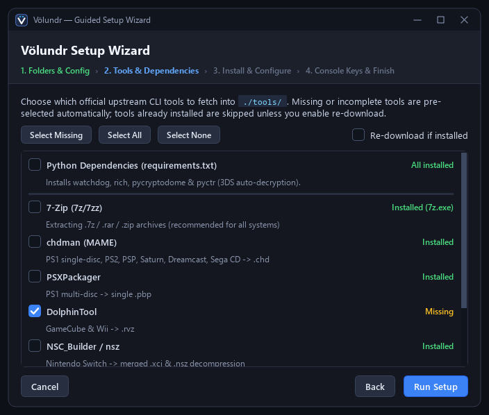

# Desktop GUI & System Tray

Völundr includes an optional native **PySide6 (Qt 6)** desktop application and system tray controller for Windows and Linux. Because `PySide6` is kept in a separate `requirements-gui.txt` file and lazy-loaded only when launching the UI, headless servers and Docker images stay completely lean.



---

## Installing & Launching

### Windows (One-Click Launcher — Easiest)
Double-click **`Start Volundr.bat`** in your `volundr` folder. On first run it automatically creates `.venv`, installs `requirements.txt` + `requirements-gui.txt`, and launches Völundr windowless (with the built-in **Setup Wizard** guiding you through folders and external tools).

*(If you already set up `.venv`, you can also launch directly via `volundr_gui.pyw` or `.\.venv\Scripts\python.exe main.py gui`.)*

### Linux / macOS
```bash
./.venv/bin/pip install -r requirements-gui.txt
./.venv/bin/python main.py gui
```

### Launch Flags

| Flag | Description |
| :--- | :--- |
| `--minimized` | Start hidden directly in the system tray |
| `--autowatch` | Start Watch mode immediately on launch (overrides your saved Settings preference) |
| `--no-autowatch` | Open in Paused state (overrides your saved Settings preference) |

---

## Interface Tour

### Forge & Activity
- **Live Glowing Status Indicator:** Shows **Auto-Forging** (green), **Forging...** (blue), **Paused** (amber), or **Error** (red).
- **Quick Controls:** Toggle **Auto Forge / Pause Forge**, trigger a one-shot **Forge Now**, or open your **Drop** and **Library** folders directly in Explorer/Files.
- **Recent Activity & Live Event Log:** Track every routed, skipped, deferred, or quarantined item alongside a real-time dark console log.
- **System Tray:** Closing the window optionally minimizes Völundr to the system tray (with a live green/amber status dot on the tray icon, desktop notifications, and a right-click quick menu).

### Doctor & Tools
Run non-blocking read-only diagnostics on your Python dependencies, disk space, NAS write/atomic-rename permissions, external CLI tools, and console keys—with a one-click **Open `tools/` Folder** shortcut and live **Refresh Diagnostics**.



### Settings & Advanced Settings
Configure `watch_dir`, `library_root`, and `post_process_action` safely (preserving all comments and formatting in `config.toml`), customize desktop/tray behavior (default startup state is **Paused**, toggleable with *Start Auto Forge automatically when Völundr launches*), and open **Advanced Settings...** for stability polling, staging headroom, PS1 PBP compression, Switch merge format, 3DS `.cia` → `.cci`, and Wii U `.wua` options.



### Guided Setup Wizard
Opens automatically on first launch (or whenever `config.toml` is missing) and can be reopened anytime from **Settings → Setup & Maintenance → Run Setup Wizard...**. It auto-detects which external CLI tools and Python dependencies are missing or partial, downloads official upstream releases via `setup_volundr.py` with live log streaming, and refreshes Doctor & Tools automatically when finished.



### One-Click Updater
Völundr checks GitHub Releases on startup (toggleable in Settings) and provides a **Check for Updates** dialog with formatted release notes and a safe one-click **Update** button (`git pull --ff-only` + dependency refresh + clean app restart). Uses `ETag` conditional caching and an automatic `releases.atom` fallback so update checks remain reliable even when GitHub's unauthenticated API rate limit is hit.
