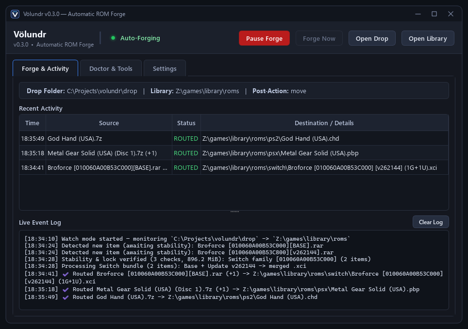

# Völundr

**Automatic ROM Forge — drop raw ROM archives in → forge clean, compressed, emulator-ready games sorted into your library automatically.**

Völundr is a cross-platform Python 3.11+ automated ROM ingestion pipeline for **Windows**, **Linux**, and **Docker**, available as both a **native Desktop GUI + System Tray app (PySide6 / Qt 6)** and a lightweight headless CLI. Drop `.zip`, `.7z`, `.rar`, raw disc images, or folders into `./drop` and Völundr identifies the console via binary headers, converts to the optimal emulator format (`.chd`, `.pbp`, `.rvz`, `.xci`, `.cci`, `.wua`, Vita3K `.zip`), and routes everything atomically into your local drive or NAS.

---

## Key Highlights

- **Native Desktop GUI & System Tray (Optional):** Dark-themed PySide6 interface with a live Watch & Activity feed, built-in graphical **Setup Wizard**, **Doctor & Tools** diagnostics, **Advanced Settings**, system tray controls, and one-click GitHub updates—while keeping the CLI & Docker images completely headless.
- **Zero-Extraction Arcade Detection:** Peeks inside `.zip`/`.7z`/`.rar` in memory and sorts arcade sets untouched into `cps1`, `cps2`, `cps3`, `neogeo`, or `fbneo`.
- **Binary Header & ISO9660 Sniffing:** Inspects magic bytes, `SYSTEM.CNF`, `PSP_GAME`, Wii U `meta.xml`, PS Vita `param.sfo`, and 3DS `NCSD`/`NCCH` encryption flags instead of trusting messy filenames.
- **Optimal Per-Console Formats:**
  - Single-disc optical (`psx`, `ps2`, `psp`, `saturn`, `dreamcast`, `segacd`, `pcenginecd`) → `.chd`
  - Multi-disc PS1 → single-file `.pbp` (+ LibCrypt `.sbi` sidecar staging)
  - GameCube & Wii → Zstd-compressed `.rvz`
  - Nintendo Switch → Base + Update + DLC merged `.xci` with library donor caching & duplicate update skipping
  - Nintendo 3DS → streaming AES-CTR decryption + `.cci` normalization + `3ds/_cia_install/`
  - Nintendo Wii U → `.wua` ZArchive compression + optional WUP/NUS decryption
  - PlayStation Vita → Vita3K `.zip` repacking + `.pkg` unpacking + Cocoon FE `.dpt` tag generation
- **Syncthing & Samba Safe:** Stages locally in `.staging/`, streams to `~syncthing~*.tmp`, verifies byte sizes, and commits atomically via `os.replace()`.
- **Guided Setup Script:** Get running in 3 steps with `python setup_volundr.py`.

### Zero-Extraction Archive & Header Inspection

---

## Where to Go Next

| Guide | What's Inside |
| :--- | :--- |
| **[Getting Started](getting-started.md)** | 3-step guided setup (`setup_volundr.py`), manual setup, CLI commands, and Linux tips |
| **[Desktop GUI](desktop-gui.md)** | PySide6 desktop app, system tray, graphical Setup Wizard, Advanced Settings, and one-click updater |
| **[Tools & Keys](tools-and-keys.md)** | Official download links for external CLI tools, `tools/` folder map, and user-supplied keys (`prod.keys`, 3DS keys, PSV TSVs) |
| **[Supported Consoles](consoles.md)** | Detailed conversion, multi-disc, CUE healing, and routing behavior for every console |
| **[Docker & NAS](docker-nas.md)** | 24/7 headless Docker deployment, volume mounts, Syncthing safety, and ROMarr two-library setup |
| **[Configuration](configuration.md)** | Complete `config.toml` & `config.docker.toml` reference |
| **[Architecture](architecture.md)** | `src/` module map and running the unit test suite |

---

!!! note "Project Status & Legal Disclaimer"
    Völundr is a personal homelab project shared as-is under the GNU General Public License v3.0 (GPLv3). Pull requests and bug reports are welcome; support is best-effort.

    Völundr includes **no** copyrighted ROMs, games, BIOS files, console decryption keys, license databases, or third-party executables. Users must supply their own legal game dumps, console keys dumped from hardware they own, and third-party CLI tools.
